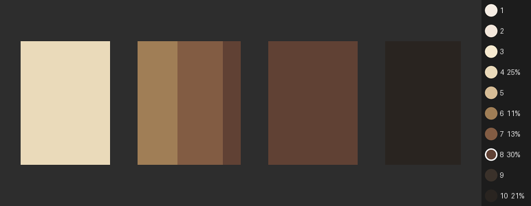

# iqkit

A small Python toolkit for camera image-quality work: recover a camera's **tone curve**, map pixels onto
Ansel Adams' **Zone System**, and test how skin tones are rendered using the **Monk Skin Tone (MST) scale**,
with optional automatic face detection.



*The demo above comes from a synthetic scene (`examples/make_demo.py`), so the repository contains no photos of people.*

<<<<<<< HEAD
> **Status: early (v0.1), a personal learning and portfolio project.** It is not affiliated with or endorsed by
> Imatest, Google or OpenCV, and it is not a replacement for calibrated lab software.
=======
> **Status: early (v0.2), a personal learning and portfolio project.** It is not affiliated with or endorsed by
> Imatest, Google or OpenCV, and it is not a replacement for calibrated lab software.
>>>>>>> ba4264c (Add face detection, skin colour qualifier, forehead/cheek comparison and colour isolation)
> See [Limitations](#limitations) before trusting any number it prints.

## What it does

| Area | What you can do |
|---|---|
| **Tone curves** | Built-in Rec.709, sRGB and gamma curves, or recover a curve from step-chart measurements (handles noise, clipping and a black floor). Convert between exposure in stops, encoded signal and IRE. |
| **Zone System** | Table of the IRE and code values each zone (0 to X) should read, with a gray-card correction. Zone map and false-colour image of any photo. |
| **Skin tone (MST)** | The ten MST reference colours with CIELAB values, CIE76 and CIEDE2000 colour differences, where each level should land on a camera curve, region measurement, and a scan that finds skin pixels, restricts them by zone and reports the nearest MST level per region. |
| **Faces** | Face detection with the YuNet neural detector or a built-in Haar fallback, then one combined skin result per face, with a report of any face that produced no result and why. |
| **Skin qualifier** | Inside each face, skin is selected by hue, chroma and lightness range, like Resolve's HSL qualifier: seeded from the face's own colour (the eyedropper), eyes, brows, mouth and nostrils left out, specks cleaned, mask exportable. Fixed forehead and cheek patches remain available with `--skin patches`. |
| **Patch comparison** | Forehead, left cheek and right cheek are also measured independently and compared (L\*, chroma, hue, zone, nearest MST level, ΔE2000), with notes on likely causes of a mismatch (facial hair, fringe or hat, shine, uneven lighting) and an optional comparison picture. |

## Install

Requires Python 3.10 or newer.

```bash
git clone https://github.com/YOUR-USERNAME/iqkit.git
cd iqkit
python3 -m venv .venv
source .venv/bin/activate          # Windows: .venv\Scripts\activate
python3 -m pip install -e ".[faces,dev]"
python3 -m pytest
```

`[faces]` installs OpenCV 4 for face detection (the `<5` pin is deliberate, see
[Face detection](#face-detection)). Without it everything except `--faces` still works.

## Quick start

No photos needed:

```bash
python3 examples/make_demo.py                    # writes examples/demo_scene.png
iqkit table --curve rec709                       # IRE per zone for a Rec.709 camera
iqkit mst-table --curve rec709                   # where each Monk level lands on that curve
iqkit mst-scan examples/demo_scene.png --curve srgb --out docs/demo_overlay.png
```

(`python3 -m iqkit.cli ...` is equivalent to `iqkit ...`.)

Zone table for a Rec.709 camera exposed so that an 18% gray card sits at its nominal level:

```
zone  stops      lin     IRE  8b legal  10b legal  status
   0     -5   0.0056     2.5        22         86  ok
   5     +0   0.1800    40.9       106        422  ok
   7     +2   0.7200    84.9       202        808  ok
   8     +3   1.4400   100.0       235        940  clipped
```

Where each MST level should land on the same curve (`EV to V` is the exposure change that would put
that level at middle gray):

```
MST     L*  stops  zone    IRE  EV to V  status
  1   94.2  +2.25  7.25   92.6    -2.25  ok
  6   55.1  +0.36  5.36   46.9    -0.36  ok
 10   14.6  -3.29  1.71    8.3    +3.29  ok
```

## Commands

| Command | Purpose |
|---|---|
| `iqkit table` | IRE and code values per zone for a curve (`--curve rec709\|srgb\|gamma22\|gamma24`, or `--csv steps.csv`). |
| `iqkit zonemap IMAGE` | Zone histogram and a false-colour zone image (`--out zones.png`). |
| `iqkit mst-table` | Expected placement of the ten MST levels on a camera curve. |
| `iqkit mst-roi IMAGE --roi x,y,w,h` | Measure one rectangle: Lab, chroma, hue, nearest MST level, zone. `--expect N` adds ΔE2000, ΔL\*, ΔC\*, Δh against level N. |
| `iqkit mst-scan IMAGE` | Find skin, classify it, and report per region or per face. |

Options shared by the curve-based commands: `--curve NAME`, or `--csv FILE` to recover a curve from measurements
(`--max-value 255` if the CSV holds 8-bit values), and `--gray 0.45` / `--gray-ire 45` to tell the tool where your
18% gray card actually reads.

Useful `mst-scan` options:

| Option | Meaning |
|---|---|
| `--faces` | Detect faces and measure skin patches inside them (one result per face). |
| `--skin qualifier\|patches` | How skin is chosen inside a face. `qualifier` (default) selects it by colour range; `patches` uses fixed forehead and cheek rectangles. |
| `--q-hue lo,hi`, `--q-chroma lo,hi`, `--q-luma lo,hi` | Set a qualifier range yourself (hue in degrees, chroma, L\*). Any range you leave out stays seeded from the face. |
| `--q-hue-tol 18`, `--q-luma-tol 28`, `--q-clean 1` | Width of the seeded hue and lightness ranges, and how much the selection is cleaned (hole filling then speck removal; 0 = off). |
| `--mask-out FILE` | Save the selected skin as a black-and-white mask. The overlay also outlines it. |
| `--face-parts cheeks\|forehead\|all` | With `--skin patches`: which patches feed the combined result. Every area is also measured and compared on its own. |
| `--compare-out FILE` | Write a picture comparing each face's forehead and cheek patches: the actual pixels, the measured colour and the matched MST swatch. |
| `--face-method auto\|yunet\|haar`, `--face-model PATH` | Detector choice. `auto` uses YuNet if its model file is found, else Haar. |
| `--zones 4-7` | Keep only pixels in this zone range, to separate lighting from skin tone. |
| `--wb x,y,w,h` | White-balance from a gray card in the frame. Strongly recommended. |
| `--mask FILE` | Use your own mask (white = skin) instead of automatic detection. |
| `--hue min,max`, `--chroma min,max` | Skin colour gate (defaults 35,95 and 3,45; wider with `--faces`). |
| `--out FILE`, `--no-legend` | Save the overlay picture, with or without the MST orb panel. |
| `--overlay original\|paint\|isolate` | `original`: your photo with face outlines, selection outline and MST chips. `paint`: skin repainted in MST swatch colours. `isolate`: colour only on the selected skin, everything else black and white, no marks on the faces. |
| `--side-by-side` | With `isolate`: put the untouched photo next to the isolated one, to compare the skin colour. |
| `--isolate-region skin\|face`, `--feather 2` | With `isolate`: keep colour on the qualified skin (eyes and lips go gray) or on each whole face; soften the edge by this many pixels (0 = hard). The isolated picture is saved at full resolution. |

The step-chart CSV for curve recovery has the header `stops,value`: each patch's exposure in stops relative to
the 18% gray patch, and its measured mean encoded value.

## Using it as a library

```python
import numpy as np
from iqkit import tone, skintone

curve = tone.ToneCurve.standard("rec709")
for row in tone.zone_table(curve):
    print(row["zone"], round(row["ire"], 1), row["status"])

# recover a curve from measured patches (stops from middle gray, values 0..1)
stops = np.arange(-6, 3.01, 0.5)
values = tone.oetf_srgb(0.18 * 2.0 ** stops)
curve = tone.recover_curve(stops, values)

for r in skintone.mst_placement(curve):
    print(r["level"], round(r["zone"], 2), round(r["ire"], 1))
```

## Face detection

* **YuNet (recommended).** A small neural detector from the OpenCV Zoo (MIT licence). It copes with several
  faces, tilt and partial occlusion much better than Haar, and its eye and mouth landmarks place the skin
  patches accurately. Download the model once, see [`models/README.md`](models/README.md).
* **Haar (fallback).** Bundled with OpenCV 4, no download, but weak: it mostly finds upright, frontal,
  well-lit faces and often misses turned or shadowed ones. The code also searches slightly rotated copies and
  requires agreement between passes to cut false positives. Always check the overlay for missing faces.
* **OpenCV 5.** OpenCV 5 moved the Haar detector into optional contrib modules, so this project pins
  `opencv-python-headless<5`.

The YuNet integration follows OpenCV's documented API and its parsing and geometry are unit-tested with
synthetic data. Verify it on your own images before relying on it.

## How it works

* Exposure is measured in **stops relative to 18% middle gray**. **Zone = stops + 5**: zone V is middle gray and each
  zone is one stop (zones 0 to X).
* **IRE = 100 × encoded signal** (full range). Legal-range 8-bit and 10-bit code values are shown separately.
* A `ToneCurve` maps exposure to signal and back. Curve recovery drops clipped patches (keeping the lowest one as
  the saturation point), collapses black-floor patches, and enforces monotonicity with isotonic regression.
* Colour: sRGB to CIELAB with a D65 white point; ΔE76 and CIEDE2000 (checked against the published Sharma test pairs).
* The nearest MST level is found by CIE76 distance to the ten reference colours, as in Cheng (2024).
* Per-face results use the median Lab colour of the patch pixels that survive the exposure, zone and colour filters.
* **Qualifier.** Per face, the seed colour is the trimmed median Lab of a core region (the darkest 15% and lightest 10% are
  dropped, so hair and shine cannot move it). The qualifier keeps pixels within a hue range (default ±18°), a chroma range
  (±(7 + 50% of the seed's chroma)) and a wide L\* range (default ±28, so lit and shaded skin both count). Eyes with brows,
  mouth and nostrils are cut out first, using the detector's landmarks (or typical positions for Haar boxes). Defaults
  were set by looking at a few images and are starting points, not calibrated values.
* Forehead and cheeks are also measured separately. They "agree" when their nearest MST levels are at most one level
  apart and the forehead-vs-cheeks CIEDE2000 is at most 5. These thresholds are heuristics, and the notes about
  causes (facial hair, fringe, shine, lighting) are possibilities to check on the picture, not diagnoses.

## Limitations

* **MST is a digital scale, not a measured reference.** There is no validated physical MST chart, and printing or
  displaying the raw sRGB values is unreliable (Cheng 2024). It is also not strictly monotonic in lightness (MST 3 is
  lighter than MST 2). Use it to organise tests, not to label people.
* **The result depends on lighting, white balance and the camera's rendering**, not only on the person. Use a gray card
  and `--wb`. Under a warm colour cast, neutral objects can pass the skin colour gate.
* **The qualifier is a colour heuristic.** Hair, beards, glasses frames and shadows of similar hue can still pass, and light
  or gray facial hair is hard to separate from skin by colour. Very dark skin has low chroma, so its hue is less reliable.
  Save the mask (`--mask-out`) and look at it before trusting a number.
* **Shading mixes with skin tone.** One face spans several zones, so its pixels match several MST levels. Prefer the
  per-face median, and use `--zones` to select the well-lit part.
* **Colour handling.** Pictures are read as sRGB: an embedded colour profile (for example Display P3 from a phone) is
  converted to sRGB first, and the camera's EXIF rotation is applied. Pictures the tool saves carry an sRGB profile so
  viewers do not have to guess. Full-range values are assumed, and 16-bit images are not colour-converted.
* **Tone curves are single-channel** (one curve, not separate R, G and B).
* **MST placement is a model**: it treats each swatch as a diffuse reflector with the luminance implied by its L\*.
* **Detection is not validated here.** Measure the detection rate by lighting condition and skin tone on your own
  consented images before drawing conclusions.
* Not yet validated against Imatest or other lab software.

## Privacy and ethics

* Only photograph people with their consent, and keep those photos out of the repository (`.gitignore` blocks
  common image types at the repo root, and `photos/` and `private/`).
* Do not commit third-party charts or images you do not have the right to share.
* Skin-tone bins describe a measurement under particular conditions. They are not identity, ethnicity or race.

## Roadmap

* Exposure-sweep command: recover a camera's tone curve from a bracket of one uniform surface (no chart needed).
* Patch measurement from a chart photo, and validation of recovered curves against Imatest output.
* Detection-rate evaluation across lighting conditions and skin tones.
* Separate R, G, B curves; ICC handling; log-curve presets.

## Development

```bash
python3 -m pip install -e ".[dev]"
python3 -m pytest -rs
```

The tests use synthetic images with known answers, plus a public-domain sample photo from scikit-image for the
face-detection tests (they skip themselves if OpenCV or scikit-image are missing).

```
iqkit/            package: tone.py (curves, zones), skintone.py (MST, colour maths), scan.py, faces.py,
                  compare.py (forehead vs cheeks), qualify.py (colour qualifier), cli.py
tests/            unit tests
examples/         make_demo.py (synthetic scene)
docs/             images used in this README
models/           where the YuNet model file goes (not committed)
```


## Credits and licences

* Code: [MIT](LICENSE).
* **Monk Skin Tone Scale** by Dr. Ellis Monk, developed with Google, published at <https://skintone.google> under
  CC BY 4.0. Colour values as tabulated in Cheng, *J. Imaging Sci. Technol.* 68(5), 2024.
* **YuNet** face detector: Wu et al., *YuNet: A Tiny Millisecond-level Face Detector*, via the OpenCV Zoo (MIT).
* **CIEDE2000**: Sharma, Wu and Dalal, *Color Res. Appl.* 30(1), 2005.
* Built on NumPy, SciPy, Pillow and OpenCV.
